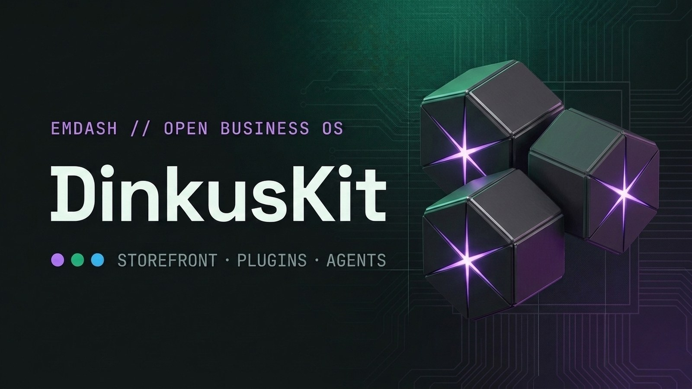
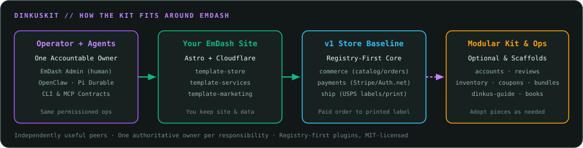

  <picture>
    <source media="(prefers-color-scheme: dark)" srcset="https://raw.githubusercontent.com/dinkuskit/.github/main/profile/assets/banner-dark.jpg">
    <source media="(prefers-color-scheme: light)" srcset="https://raw.githubusercontent.com/dinkuskit/.github/main/profile/assets/banner-light.jpg">
    
  </picture>

  
  
  
  
  

  <a href="https://dinkuskit.com">Website</a> &middot;
  <a href="https://github.com/dinkuskit/.github/blob/main/VISION.md">Vision</a> &middot;
  <a href="https://github.com/dinkuskit/.github/blob/main/ROADMAP.md">Scope &amp; Planning</a> &middot;
  <a href="https://github.com/dinkuskit/.github/blob/main/CONTRIBUTING.md">Contributing</a>

  <strong>DinkusKit helps one accountable operator run a business through independently useful, connected tools—with agents doing more of the routine work as reliability and trust grow.</strong>

> **dinkus** (`* * *`) — three stars used as a section break.

A kit of open-source plugins, services, and templates built around [EmDash](https://github.com/emdash-cms/emdash). Commerce is our first proving ground; the destination is a business operating system. One accountable operator can work with employees, contractors, and agents across several sites.

The design constraint: **a non-technical human can run the business from the admin, with agents using the same permissioned operations.** Adopt useful pieces alongside existing tools, choose your assistant, and keep control of your data and what an agent may do. These are product principles; individual repositories document what is implemented and proven today.

  <picture>
    <source media="(prefers-color-scheme: dark)" srcset="https://raw.githubusercontent.com/dinkuskit/.github/main/profile/assets/kit-architecture-dark.svg">
    <source media="(prefers-color-scheme: light)" srcset="https://raw.githubusercontent.com/dinkuskit/.github/main/profile/assets/kit-architecture-light.svg">
    
  </picture>

## Current focus

**v1** is a working EmDash store a non-technical human runs from the admin—from listing products to a paid order to a printed USPS label. The broader vision does not add every future capability to that release.

✱ &nbsp; ✱ &nbsp; ✱

## 🛒 Plugins: make it sell

| Repository | Role | Scope / Status |
| --- | --- | --- |
| 🛒&nbsp;[**commerce**](https://github.com/dinkuskit/commerce) | Open-source commerce layer for EmDash sites: products, prices, cart, checkout, orders, and receipts | **v1 baseline** |
| 💳&nbsp;[**payments**](https://github.com/dinkuskit/payments) | One card processor per store (Stripe or Authorize.net) with server-owned webhooks | **v1 baseline** |
| 📮&nbsp;[**ship**](https://github.com/dinkuskit/ship) | USPS label quotes, purchase, printing, and tracking from the store admin | **v1 baseline** |
| 👤&nbsp;[**accounts**](https://github.com/dinkuskit/accounts) | Shopper sign-in via emailed 6-digit code, saved addresses, and storefront account pages | **Scaffold** (accounts stay in Commerce until ready) |
| ⭐&nbsp;[**reviews**](https://github.com/dinkuskit/reviews) | Buyer star ratings (1–5) and product reviews for Commerce stores | **Scaffold** (rating rules only; not collecting yet) |
| 📦&nbsp;[**inventory**](https://github.com/dinkuskit/inventory) | Pools, locations, immutable movements, reservations, and reconciliation | **Optional for v1** |
| 🏷️&nbsp;[**coupons**](https://github.com/dinkuskit/coupons) | Coupon codes, promotion rules, limits, and companion Worker service | **Optional for v1** (tested scaffold) |
| 🎁&nbsp;[**bundles**](https://github.com/dinkuskit/bundles) | Mix-and-match product selection, pricing, inventory, and fulfillment | **Later candidate** |

These rows describe component responsibilities, not a claim that every feature is released. Inventory and coupons are optional for the v1 baseline; accounts, reviews, and bundles remain scaffolds or later candidates. Check each repository for current status.

## 🧭 Beyond the storefront

| Repository | Role | Notes |
| --- | --- | --- |
| 🌐&nbsp;[**dinkuskit**](https://github.com/dinkuskit/dinkuskit) | EmDash-powered public website and merchant account experience | Powers [dinkuskit.com](https://dinkuskit.com) |
| 🦀&nbsp;[**openclaw**](https://github.com/dinkuskit/openclaw) | Connect custom OpenClaw agents and gateways to EmDash admin | Block Kit approval cards + MCP tools |
| ⚡&nbsp;[**pi-durable**](https://github.com/dinkuskit/pi-durable) | Serverless Pi Durable agent (Cloudflare Worker + Durable Object) | Public runnable scaffold |
| 🧭&nbsp;[**DinkusGuide**](https://github.com/dinkuskit/dinkus-guide) | Read-only, source-backed guide to DinkusKit and EmDash | Reproducible evaluation corpus |
| 📚&nbsp;[**books**](https://github.com/dinkuskit/books) | Bookkeeping, reconciliation, and tax-readiness direction | Design stub (not an installable plugin) |

We aim for independently useful tools, deliberate integrations, portable business knowledge, and a practical path to run the system in your own Cloudflare account. That path, broader business capabilities, and agent controls still need design and proof; they are not promises of current availability.

## 🚀 Templates: make it yours

| Repository | Best for | Notes |
| --- | --- | --- |
| 🛍️&nbsp;[**template-store**](https://github.com/dinkuskit/template-store) | Storefronts built on DinkusKit Commerce | Payments and Ship join it for v1 |
| 🧰&nbsp;[**template-services**](https://github.com/dinkuskit/template-services) | Service businesses (trades, quotes, bookings) | Astro + EmDash starter |
| 📣&nbsp;[**template-marketing**](https://github.com/dinkuskit/template-marketing) | Lean marketing and launch sites | Astro + EmDash starter |

✱ &nbsp; ✱ &nbsp; ✱

  Under construction and dogfooding in the open. Registry-first plugins, MIT-licensed. Follow each repository's releases and verification notes for availability.

